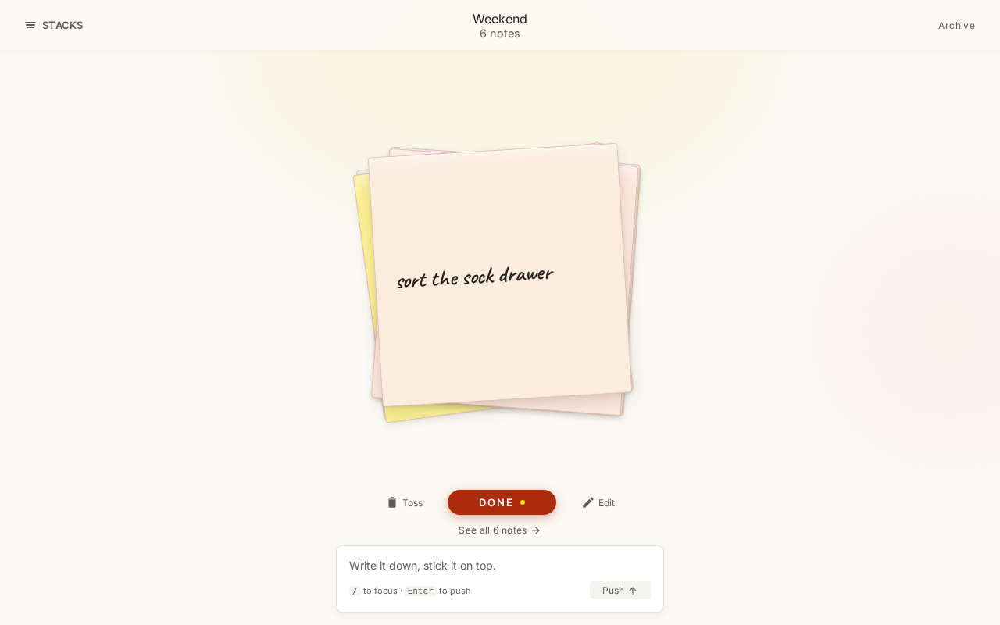
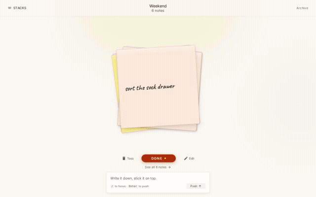

# task-stack

A single-user task stack for the web. Push notes onto a pile; only the top one
is readable. Finish it, and it pops off in a small ceremony — the note lifts,
crumples, burns, drifts away — revealing whatever was underneath. Everything
below the top stays out of sight until it matters.



Popping a note takes a moment, on purpose:



## Features

- **FILO stack** — new notes go on top; nothing below is readable. Depth you
  can feel, decisions you don't have to make yet.
- **Done, with ceremony** — completing the top note runs the burn ritual and
  files the note into the archive.
- **Toss** — a quiet delete, no ritual, for notes that were a bad idea.
- **Edit inline**, and a **list view** with drag-reorder when you want to see
  everything at once.
- **Multiple stacks** with one globally-active stack: switching on one device
  switches all of them.
- **Live sync** across devices over WebSocket (`/api/ws`, full-state
  broadcast).
- **Archive** of completed notes, grouped by calendar day.
- **Export** — `GET /api/export` dumps the whole instance as JSON.
- **Keyboard** — `/` focuses quick-add, `Enter` pushes, `Esc` closes/clears.

No auth, no accounts, no offline mode — deliberately. One person, one pile of
paper. See [Privacy & hygiene](#privacy--hygiene).

## Self-host with Docker

The intended way to run it. This is the condensed path — the full runbook
(first-deploy checks, reboot test, updates, rollback, backups,
troubleshooting) lives in [DEPLOY.md](DEPLOY.md).

1. Clone:

   ```sh
   REPO_URL=""   # ← put your clone URL here
   git clone "$REPO_URL" task-stack && cd task-stack
   ```

2. Pre-create the data directory with the right owner — **do not skip this**.
   The image runs as uid 1000; a root-owned `data/` makes SQLite unwritable
   and the container crash-loops (`SQLITE_CANTOPEN`):

   ```sh
   mkdir -p data && sudo chown 1000:1000 data
   ```

3. Configure:

   ```sh
   cp -n .env.example .env   # -n: never clobbers an .env you already edited
   ```

   Defaults: `HOST_PORT=8181`, `BIND_ADDR=0.0.0.0`, `IMAGE_TAG=latest`.

4. Build and start:

   ```sh
   docker compose up -d --build
   ```

5. Verify:

   ```sh
   curl --retry 10 --retry-delay 1 --retry-connrefused -fsS http://127.0.0.1:8181/api/health   # {"ok":true}
   ```

Open `http://<machine-address>:8181` from another device on the same network,
push a note in one window, and watch it land in the other. If anything
misbehaves, [DEPLOY.md](DEPLOY.md) §9 is the troubleshooting table.

## Run from source

mise is the only prerequisite — `mise.toml` pins node and pnpm exactly
(the server uses the built-in `node:sqlite` module, which needs node ≥ 24.15).
`mise install` provisions them; to use them, activate mise in your shell once
(`eval "$(mise activate bash)"` — see mise's docs for other shells) or prefix
each command below with `mise exec --`.

```sh
mise install
pnpm install
pnpm build                 # shared, then server + web
pnpm start                 # = node server/dist/index.js
```

One process serves both `/api` and the built web app, at
`http://127.0.0.1:3000`. Data lands in `server/data.db` unless `DB_PATH` says
otherwise.

For development with hot reload (two processes; Vite proxies `/api` to the
server):

```sh
pnpm --filter server dev   # Fastify via tsx watch, http://127.0.0.1:3000
pnpm --filter web dev      # Vite, http://localhost:5173
```

## Configuration

| Variable       | Used by        | Default                | What it does                                                            |
| -------------- | -------------- | ---------------------- | ----------------------------------------------------------------------- |
| `HOST_PORT`    | docker compose | `8181`                 | Host port published for the container                                   |
| `BIND_ADDR`    | docker compose | `0.0.0.0`              | Host address the port binds to (`127.0.0.1` locks it to the machine)    |
| `IMAGE_TAG`    | docker compose | `latest`               | Image tag built/used; the rollback knob in DEPLOY.md §6                 |
| `PORT`         | source runs    | `3000`                 | Port the server listens on                                              |
| `HOST`         | source runs    | `127.0.0.1`            | Address the server binds to                                             |
| `DB_PATH`      | source runs    | `server/data.db`       | Where the SQLite file lives                                             |
| `WEB_DIST_PATH`| source runs    | auto-detected `web/dist` | Where the built web app is served from                                |

The compose variables are read from `.env`. On Docker images, `PORT`, `HOST`,
`DB_PATH` and `WEB_DIST_PATH` are baked in (`PORT=3000`, `HOST=0.0.0.0`,
`DB_PATH=/data/data.db`, `WEB_DIST_PATH=/app/web/dist`) — they only matter for
source runs.

## Privacy & hygiene

- **No auth.** Anyone who can reach the URL can read and edit every stack.
  Never publicize the deployed URL — keep it LAN-only or behind a reverse
  proxy. The server does send `X-Robots-Tag: noindex`, but that is a courtesy,
  not a lock.
- The deployment and repository origin URLs never appear in this repo's docs
  or issues.
- All state is one SQLite file (`./data/data.db` under compose) — but it runs
  in WAL mode, so don't copy a live `data.db` on its own. Take backups one of
  two ways: `GET /api/export` gives the whole instance as JSON, safe to fetch
  any time; or stop the container (`docker compose stop`), copy `data.db`
  plus any `-wal`/`-shm` siblings, and start it again. The exact recipe is
  [DEPLOY.md](DEPLOY.md) §8.

## Testing

```sh
pnpm lint                                            # ESLint + Prettier check
pnpm -r test                                         # unit tests (Vitest)
pnpm --filter @task-stack/web exec playwright install chromium  # once per machine
pnpm --filter @task-stack/web test:e2e               # Playwright e2e
```

The docs/images assets were captured from the built app by
[docs/capture.mjs](docs/capture.mjs) — see the header comment there for
usage.

## Credits

- Inspired by the task stack system described by Dave Gauer at
  https://ratfactor.com/stack/ — concept credit only; no text or artwork is
  borrowed from the article.
- Handwritten font: Caveat, self-hosted under the SIL Open Font License.
- Licensed MIT — see [LICENSE](LICENSE).
